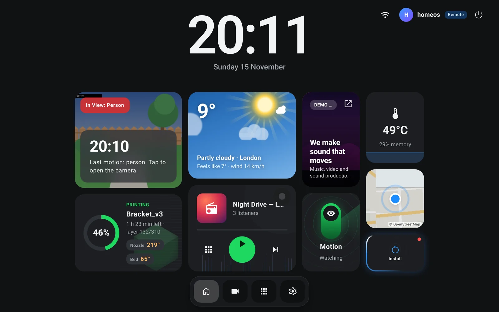
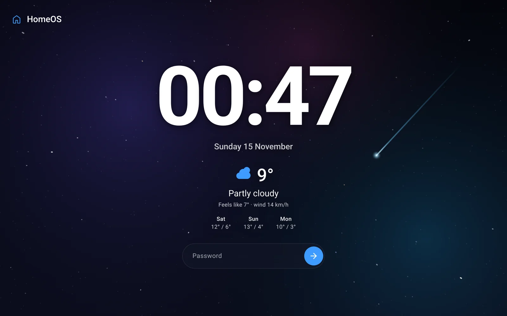
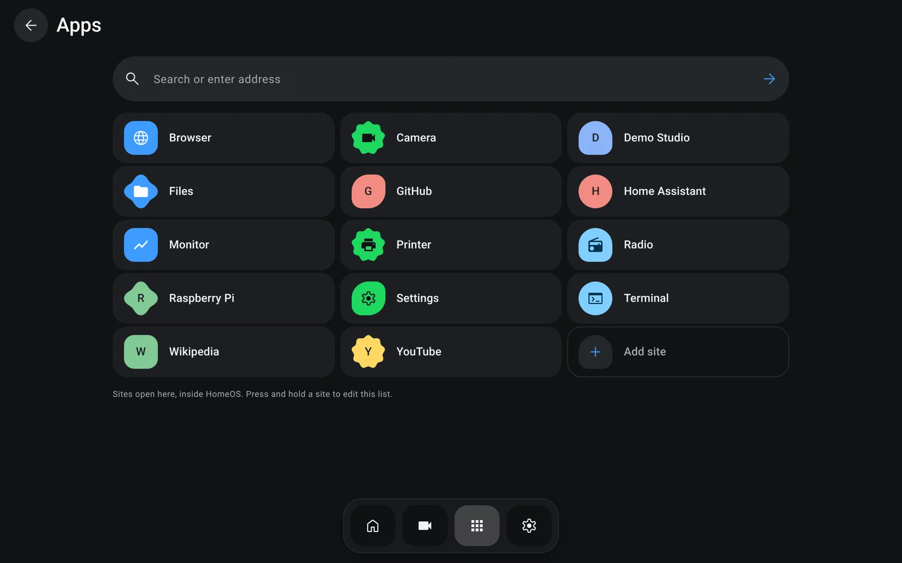
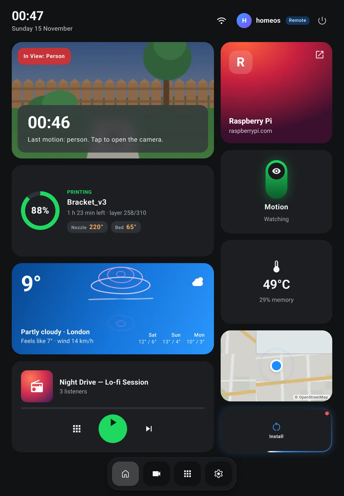
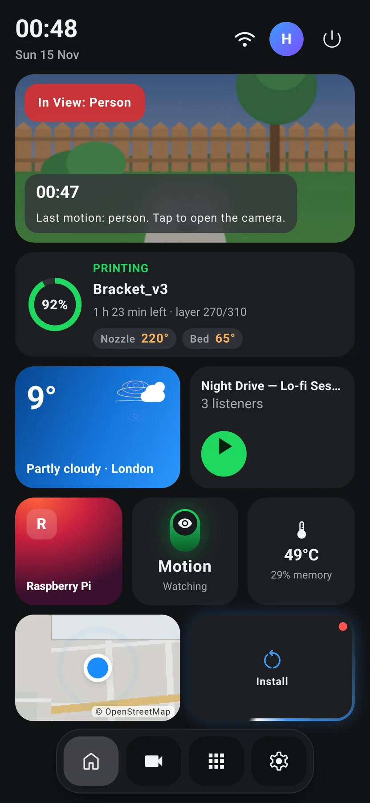
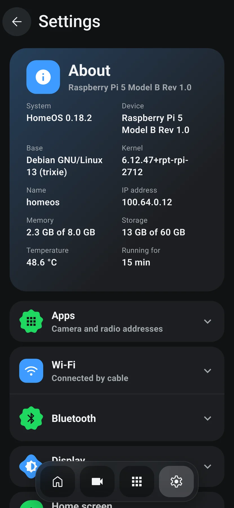

<h1 align="center">HomeOS</h1>

<p align="center">
  <b>A touch-first home dashboard and shell for the Raspberry Pi</b><br>
  On the Pi's own screen, and in any browser on your phone, tablet or computer.
</p>

<p align="center">
  
  <a href="LICENSE"></a>
  
  
</p>

<p align="center">
  
</p>

<p align="center">
  <a href="#install">Install</a> ·
  <a href="#features">Features</a> ·
  <a href="#screenshots">Screenshots</a> ·
  <a href="#web-access-and-security">Security</a> ·
  <a href="#bambu-lab-printer">Printer</a> ·
  <a href="CONTRIBUTING.md">Contributing</a>
</p>

---

HomeOS turns a Raspberry Pi running **Raspberry Pi OS Lite (64-bit)** into a small home
hub: a widget dashboard, a camera viewer with motion events, a Bambu Lab printer
monitor, radio, files, a system monitor, a terminal and a browser — with Material Design 3
Expressive styling, light and dark themes and smooth animations.

- **No build step, no dependencies.** The services are plain Python 3 (standard library
  only); the interface is plain HTML, CSS and JavaScript.
- **Private by default.** Web access listens only on the Pi and on its
  [Tailscale](https://tailscale.com) address, behind a password.
- **One-tap updates** from Settings: `git pull` and reinstall.

## Install

### Option 1 — a ready SD card image

1. Download the image for your Pi from the
   [Releases page](https://github.com/vityapotapchuk/homeos/releases)
   (no release yet? use Option 2 below):
   - `homeos-pi5-*.img.xz` — Raspberry Pi 5, full edition (desktop on the screen, web access, browser, camera)
   - `homeos-zero2w-*.img.xz` — Raspberry Pi Zero 2 W, lite edition (web access only)
2. Write it with [Raspberry Pi Imager](https://www.raspberrypi.com/software/) → *Choose OS* →
   *Use custom*. In Imager's OS customisation set a user, password, Wi-Fi and SSH.
3. Open the card's `bootfs` drive and fill in `homeos.txt`: the web password and,
   optionally, a [Tailscale auth key](https://login.tailscale.com/admin/settings/keys).
   The secrets are wiped from the card after the first boot.
4. Boot the Pi. The first start takes a few minutes longer. Then open
   `http://homeos.local:8790` on your home network, or the Pi's Tailscale address.

### Option 2 — on an existing Raspberry Pi OS Lite

```sh
sudo apt install -y git
git clone https://github.com/vityapotapchuk/homeos.git ~/homeos-src
cd ~/homeos-src
sudo ./install.sh --web
sudo reboot
```

The installer asks for a web password (8+ characters) and prints the address to open.

| Command | What it does |
|---|---|
| `sudo ./install.sh` | desktop on the Pi's screen only, starts on boot |
| `sudo ./install.sh --web` | desktop **and** web access |
| `sudo ./install.sh --web-only` | web access only; the Pi keeps booting to the console |
| `sudo ./install.sh --web-only --lite` | small edition for a Pi Zero 2 W: no browser, no camera |
| `sudo ./install.sh --no-packages` | update HomeOS files only |
| `sudo ./uninstall.sh` | remove HomeOS (system packages stay) |

**Requirements:** Raspberry Pi OS Lite (64-bit) · Raspberry Pi 5 (full)
or Zero 2 W (lite) · for remote access, a free [Tailscale](https://tailscale.com) account.

### Updating

Settings → Updates → *Check for updates*, then *Install*. The update widget on Home lights
up when a new version is waiting. From the console:
`cd ~/homeos-src && git pull && sudo ./install.sh --no-packages`.

## Features

| | |
|---|---|
| **Start page** | Large clock, weather and an animated night sky — 3D star field, nebula light, falling comets. It is also the sign-in page. |
| **Home** | Widgets that always fill the screen: camera, 3D printer, weather, radio, a featured site, motion detection, Pi temperature, an OpenStreetMap map, updates. Layouts for big landscape screens (large clock on top), upright tablets, phones (everything on one screen) and 800×480 Pi displays. |
| **Camera** | Live MJPEG camera (for example an ESP32-CAM) relayed by the Pi, with light, flip, resolution, brightness, contrast and frame-rate controls, photos and motion events. |
| **Printer** | Bambu Lab printers on your LAN: job, progress, layer, time left, temperatures, fan, the printer's camera, a picture of the model being printed, pause / resume / stop, light, speed. |
| **Files** | The user's home folder: browse, view, upload, download, rename, delete. |
| **Monitor** | Temperature, CPU and memory history (1 h / 6 h / 24 h), disk and services. |
| **Settings** | Wi-Fi and Bluetooth, display and theme, widgets, apps, printer, sign-in, sound, updates, about. |
| **Terminal** | A real shell of the Pi user in the browser (can be switched off). |
| **Browser** | On the Pi's screen a WebKit browser with tabs. On the web, sites open inside HomeOS; sites that refuse to be framed open in a headless Chromium on the Pi, streamed to you. |

## Screenshots

| Start page and sign-in | Camera with motion events |
|---|---|
|  |  |
| **Bambu Lab printer** | **Settings** |
|  |  |
| **Apps** | **Home on an upright tablet** |
|  |  |

<p align="center">
  
  
  
</p>

<p align="center"><sub>Screenshots use demo data.</sub></p>

## Web access and security

- The web service listens only on `127.0.0.1` and on the Pi's Tailscale address — not on
  your home network or the internet. (Images without a Tailscale key also answer at
  `homeos.local` on the home network.)
- Sign-in uses a scrypt-hashed password, an HttpOnly session cookie and a CSRF token;
  after 8 failed attempts sign-in is locked for 5 minutes. A strict Content-Security-Policy
  is sent with every page.
- The web terminal is a real shell of the HomeOS user. Turn it off with
  `homeos-web --terminal off`.
- The password can be switched off for testing (Settings → Sign-in, or
  `homeos-web --no-password`); anyone in your tailnet then gets in. Turn it back on with
  `homeos-web --ask-password`.
- Only one root helper, `/opt/homeos/bin/homeos-update`, may run without a password
  (for the update button), through a sudoers rule.

| Command | What it does |
|---|---|
| `homeos-web --status` | addresses and whether a password is set |
| `homeos-web --set-password` | set or change the password |
| `homeos-web --allow-host NAME` | allow opening by a host name, not only by IP |
| `journalctl -u homeos-web` | the service log |

Found a security problem? Please see [SECURITY.md](SECURITY.md).

## Bambu Lab printer

Settings → Printer (or the Printer app): enter the printer's IP address and its LAN access
code (on the printer: *Settings → WLAN / LAN Only*). HomeOS reads the serial number from
the printer's certificate, checks each step of the connection and tells you which one
failed. The code is stored in `~/.config/homeos/printer.json`, readable by the owner only,
and is never sent to the browser.

| What | How | Needs |
|---|---|---|
| Status | MQTT over TLS, port 8883 | the access code |
| Pause, stop, light, speed | the same connection | *LAN Only* + *Developer Mode* on recent firmware |
| Camera, A1 / P1 | JPEG pictures over TLS, port 6000 | *LAN Only Liveview* |
| Camera, X1 / H2D / P2S | RTSPS video, port 322 | *LAN Only Liveview* and `ffmpeg` |
| Model picture | the `.3mf` on the printer, FTPS port 990 | — |

From the console instead: `python3 /opt/homeos/shell/printer.py <printer-ip> <access-code>`.

## Camera, radio and motion detection

- **Camera** — set the stream address in Settings → Apps (default
  `http://camera.local:81/stream`). The Pi fetches the stream and relays it, so it works
  over Tailscale too. Controls follow the ESP32-CAM web server's `/control` API.
- **Radio** — plays the stream of a radio server on the Pi; set its address in Settings → Apps.
- **Motion detection** — HomeOS shows events and clips from a detection service on port
  8084 if one is running. The service itself is not part of this repository.

## Project layout

| Path | What |
|---|---|
| [`shell/`](shell) | the Python services: `sysapi.py` (desktop API), `webshell.py` (web access), `apps.py`, `printer.py`, `metrics.py`, `updater.py`, … |
| [`shell/ui/`](shell/ui) | the interface: HTML, CSS, JavaScript, bundled fonts and icons |
| [`bin/`](bin) | the `homeos*` commands and the update helper |
| [`config/`](config) | the labwc compositor setup for the desktop |
| [`image/`](image) | building the SD card images |
| [`.github/workflows/`](.github/workflows) | checks, and the image build that publishes releases |

## Contributing

Issues and pull requests are welcome — see [CONTRIBUTING.md](CONTRIBUTING.md).

## Licence

HomeOS is released under the [MIT licence](LICENSE). Bundled third-party parts (Roboto,
Material Symbols, xterm.js) keep their own licences; see
[`shell/THIRD-PARTY.md`](shell/THIRD-PARTY.md). HomeOS is an independent project, not
affiliated with Raspberry Pi Ltd, Bambu Lab, Tailscale or Google.
