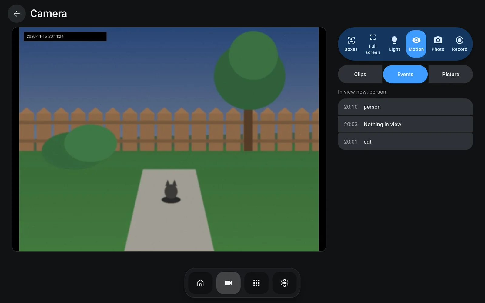
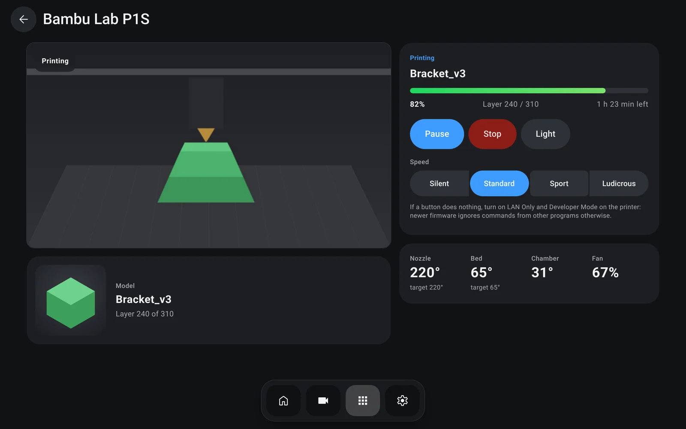
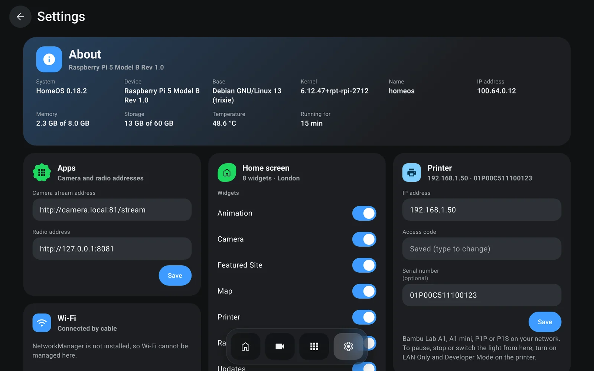
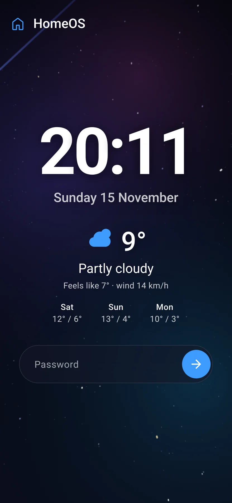

# HomeOS

A touch-friendly home dashboard and shell for the Raspberry Pi, built on top of
Raspberry Pi OS Lite (64-bit). It runs on the Pi's own screen as a desktop, and in
any browser on your phone, tablet or computer through [Tailscale](https://tailscale.com).

The design follows Google Material Design 3 Expressive, with light and dark themes,
Roboto and Material Symbols bundled, so it looks the same on the Pi and on the web.
Everything server-side is plain Python 3 (standard library only); the interface is
plain HTML, CSS and JavaScript with no build step.

## Screenshots

<p align="center">
  
</p>

| Start page and sign-in | Camera with motion events |
|---|---|
|  |  |
| **Bambu Lab printer** | **Settings** |
|  |  |
| **Apps** | **Home on an upright tablet** |
|  |  |

<p align="center">
  
  
  
</p>

<sub>Screenshots use demo data.</sub>

## What is inside

- **Start page** with a large clock, the weather and an animated night sky
  (3D star field, nebula light, falling comets). It is also the sign-in page.
- **Home** — a dashboard of widgets that always fill the screen, like a car's
  display: camera, 3D printer, weather, radio, a featured site, motion detection,
  system temperature, an OpenStreetMap map and an update button that lights up when
  an update is ready. A dock at the bottom: Home, Camera, Apps, Settings.
  Layouts for landscape and upright tablets, phones (everything on one screen) and
  800×480 Pi displays.
- **Apps** — Camera, Printer, Radio, Files, Monitor, Terminal, Browser and your own
  site tiles.
- **Camera** — live MJPEG camera (for example an ESP32-CAM), with its controls
  (light, flip, resolution, brightness, contrast, frame rate), photos, and an optional
  motion-detection service (events, clips, recording).
- **Printer** — Bambu Lab printers on your home network: job, progress, layers, time
  left, temperatures, fan, the printer's camera, a picture of the model being printed,
  pause / resume / stop, light and speed.
- **Files** — the user's home folder: browse, view, upload, download, rename, delete.
- **Monitor** — temperature, CPU and memory history (1 h / 6 h / 24 h), disk and services.
- **Settings** — Wi-Fi and Bluetooth, display, widgets, apps, printer, sign-in, sound,
  updates (one tap: `git pull` and reinstall), about.
- **Browser** — on the Pi screen a WebKit browser with tabs; on the web, sites open
  inside HomeOS, and sites that refuse to be framed open in a headless Chromium on the Pi
  whose screen is streamed to you.

## Install

1. Write **Raspberry Pi OS Lite (64-bit)** with Raspberry Pi Imager; set a user, Wi-Fi and SSH.
2. On the Pi:

   ```sh
   git clone <this repository> ~/homeos-src
   cd ~/homeos-src
   sudo ./install.sh --web      # desktop on the screen + web access
   sudo reboot
   ```

| Command | What it does |
|---|---|
| `sudo ./install.sh` | desktop only, starts on boot |
| `sudo ./install.sh --web` | desktop and web access |
| `sudo ./install.sh --web-only` | web access only (the Pi keeps booting to the console) |
| `sudo ./install.sh --web-only --lite` | small edition for a Pi Zero 2 W: no browser, no camera |
| `sudo ./install.sh --no-packages` | update HomeOS files only |
| `sudo ./uninstall.sh` | remove HomeOS (packages stay) |

### Ready-made SD card images

`.github/workflows/images.yml` builds two images from the latest Raspberry Pi OS Lite and
attaches them to a release (push a tag `images-…` or use *Run workflow*):
`homeos-pi5-*.img.xz` (full) and `homeos-zero2w-*.img.xz` (lite). After writing a card,
fill in `homeos.txt` on its `bootfs` drive (web password, optional Tailscale auth key);
the secrets are wiped from the card after the first boot.

## Web access and security

`install.sh --web` asks for a password (8+ characters) and prints the address,
for example `http://100.x.y.z:8790/`.

- The service listens only on `127.0.0.1` and on the Pi's Tailscale address — not on your
  home network or the internet.
- Sign-in uses a scrypt-hashed password, an HttpOnly session cookie and a CSRF token;
  after 8 failed attempts sign-in is locked for 5 minutes.
- The web terminal is a real shell of the HomeOS user. Turn it off with
  `homeos-web --terminal off`.
- The password can be switched off for testing (Settings → Sign-in, or
  `homeos-web --no-password`); anyone in your tailnet then gets in. Switch it back on with
  `homeos-web --ask-password`.
- The update button may run exactly one root helper, `/opt/homeos/bin/homeos-update`,
  through a sudoers rule; nothing else gets passwordless sudo.

| Command | What it does |
|---|---|
| `homeos-web --status` | addresses and whether a password is set |
| `homeos-web --set-password` | set or change the password |
| `homeos-web --allow-host NAME` | allow opening by a host name, not only by IP |
| `journalctl -u homeos-web` | the service log |

## Bambu Lab printer

Settings → Printer (or the Printer app): the printer's IP address and its LAN access code
(on the printer: Settings → WLAN / LAN Only). The serial number is read from the printer's
certificate. Connecting checks each step and says which one failed. The code is kept in
`~/.config/homeos/printer.json` (readable by the owner only) and is never sent to the browser.
From the console instead: `python3 /opt/homeos/shell/printer.py <ip> <access-code>`.

- Status: MQTT over TLS, port 8883. Recent firmware accepts commands (pause, stop, light,
  speed) only in **LAN Only** mode with **Developer Mode** on; status works either way.
- Camera: switch on **LAN Only Liveview**. A1 / P1 send JPEG pictures on port 6000;
  X1, H2D and P2S stream RTSPS video on port 322, which needs `ffmpeg` on the Pi.
- Model picture: read once per print from the `.3mf` on the printer over FTPS (port 990).

## Camera, radio and motion detection

- **Camera**: set the stream address in Settings → Apps (default `http://camera.local:81/stream`).
  HomeOS fetches the stream itself and relays it, so it works over Tailscale too.
- **Radio**: plays the stream of a self-hosted radio server on the Pi; set its address in
  Settings → Apps.
- **Motion detection**: HomeOS shows events and clips from a separate detection service on
  port 8084 if one is running; it is not part of this repository.

## Layout of the repository

| Path | What |
|---|---|
| `shell/` | the Python services (`sysapi.py` desktop API, `webshell.py` web access, `apps.py`, `printer.py`, …) |
| `shell/ui/` | the interface (HTML, CSS, JS, bundled fonts and icons) |
| `bin/` | the `homeos*` commands and the update helper |
| `config/` | the labwc compositor setup for the desktop |
| `image/` | building SD card images |
| `install.sh`, `uninstall.sh` | installer |

Third-party parts (Roboto, Material Symbols, xterm.js) and their licences are listed in
`shell/THIRD-PARTY.md`.
